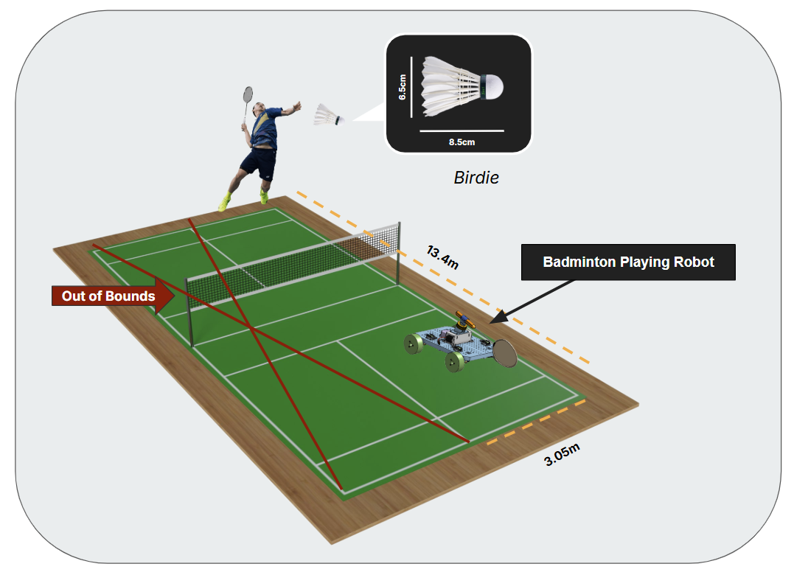
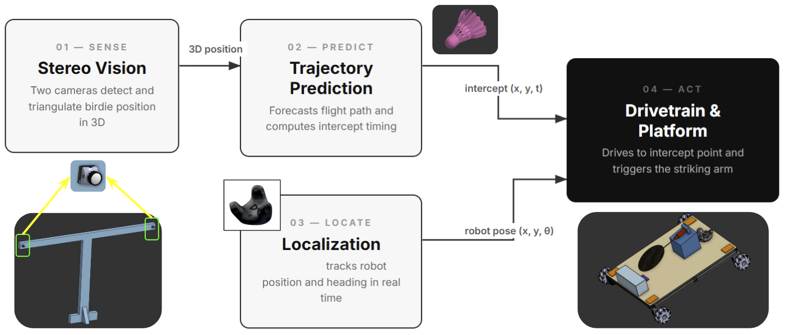

## The goal

The goal of this two-year project is to design and build a fully autonomous
badminton-playing robot capable of sustaining a reliable rally against a
human opponent.

This project is self-proposed (meaning the Engineering Physics Project Lab has chosen to sponsor us), with a 2-year timeline. The team was motivated
by the success of previous interactive, multidisciplinary engineering
projects, such as the <a href="https://www.youtube.com/watch?v=ugwpCam1rd0" target="_blank" rel="noopener noreferrer">RL air hockey agent</a>, and the desire to tackle a
complex, high-speed tracking challenge.

## Scope

The project requires tracking the birdie and robot in 3D space, predicting
trajectories, moving rapidly and returning the birdie using a striking arm. The robot must
execute these tasks quickly to strike the birdie in time, meaning typically
under 2 seconds.

To make sure the April 2027 completion deadline is met, the operational scope
is focused on returning standard rallies. Advanced manoeuvres, such as
high-velocity smashes, are out of scope. The
constraints are a half-court region and gentle rallying.

## Three systems

We divided the fully autonomous system into three sub-challenges for the year:

1. The physical chassis. Designing the mechanical drivetrain and
   electronic architecture to be capable of rapid court movements
   and striking to return birdies.
2. Trajectory prediction. Developing a highly accurate computer vision
   and tracking system, using algorithms such as an Extended Kalman Filter
   (EKF), to predict shuttlecock flight paths in real time.
3. Robot localization. Implementing a robust localization system to
   ensure the robot knows its position relative to the court.

