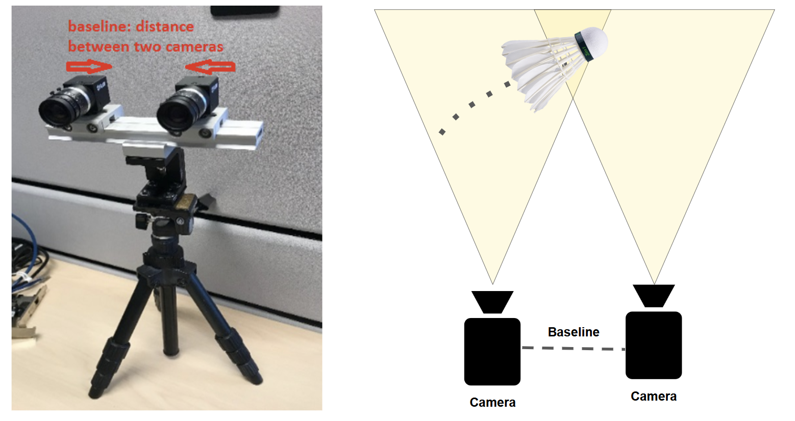
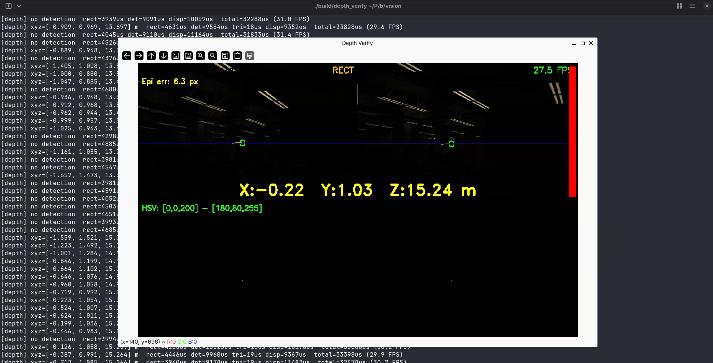
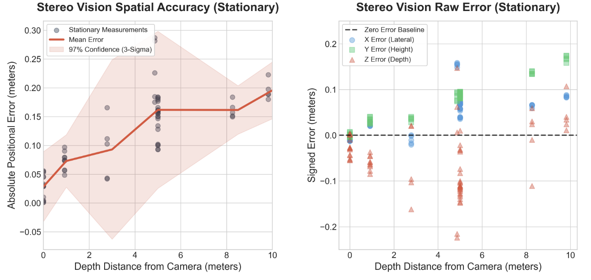

## Triangulating the birdie

The birdie tracking challenge requires identifying a fast-moving object,
tracking its 3D motion, and predicting its landing point within a strict time
budget. The vision system first triangulates the birdie's 3D position from
the stereo cameras, then integrates this data with a physics-based flight
model using an Extended Kalman Filter (EKF) to filter noisy measurements and
predict the final landing point.

A stereo camera pair consists of two cameras separated by a known baseline.
When both cameras observe the same point, its 3D position can be recovered by
triangulation. Before triangulation, both images are rectified to correct for
lens distortion and to align the cameras so that corresponding points lie on
the same horizontal scanline, reducing the correspondence search to 1D.

Depth accuracy is limited by baseline geometry. A point at distance d with
baseline b produces a disparity proportional to b/d, so depth error grows as
d²/b. With a 53.5 cm baseline (which is what we tested with), lateral (X/Y)
error is approximately 2 cm at typical operating distances and depth (Z)
error is approximately 5 cm.

## Camera hardware

To ensure precise high-speed tracking, the camera system must meet a frame
rate exceeding 100 FPS and a global shutter to mitigate rolling shutter
distortion. The optics should have a 4 to 8 mm focal length to balance court
coverage and spatial resolution, and a sensor resolution of approximately 2.5
MP keeps the birdie visible without exceeding the data bandwidth of USB 3.0.
We chose the Teledyne Blackfly S 2.3 MP (1920×1200, 165 FPS max) cameras,
bought from Teledyne.

The primary camera outputs a 3.3 V GPIO pulse at the start of each exposure,
and the secondary camera receives this as a hardware trigger, guaranteeing
both frames in each stereo pair are captured simultaneously. Without this
synchronization, a birdie moving at several metres per second would shift
position between the two exposures, introducing triangulation error. Both
cameras run with 500 µs exposure, global shutter, and fixed gain and white
balance.

The lenses were selected based on pixel visibility and stereo overlap
analysis across focal lengths of 6 to 12 mm. 8 mm was chosen as the best
tradeoff between birdie visibility at 13 m and stereo overlap down to 1.5 m.

## Calibration

We calibrated the stereo rig using Zhang's method via a ChArUco board (5×7
grid, 32 mm squares). ChArUco combines a checkerboard with embedded ArUco
markers, enabling robust corner detection even under partial occlusion.
Reliable calibration results were achieved with fewer than 18 usable image
pairs.

We did not complete the court frame registration, which maps camera
coordinates to a court coordinate system, this year. The pipeline currently
operates in camera coordinates. When we validated the stereo geometry against
a physical grid of tape markers, we found growing X/Y error with distance,
consistent with an uncalibrated world frame.

## Characterising the stereo rig

To test the accuracy and precision of the stereo vision system, we moved a
painted birdie around and measured its 3D location with respect to a mark on
the ground. The stereo vision system's 3D measurements of the birdie location
were measured and then shifted to be with respect to the same mark.

The error on average was about 15 cm. The error reduces as the birdie gets
closer to the camera, which is good, as it suggests we can fine-tune our
landing prediction as the birdie gets closer to the robot's side of the
court. The error on the right graph being linear for X and Y suggests there
was some rotational discrepancy between the world coordinate frame and the
camera coordinate frame, which can be calibrated out.

## Detection

The detector converts each frame to HSV and thresholds for bright white
regions. HSV was chosen over RGB because it separates colour from brightness,
making the threshold more robust to lighting variation. Detection runs in under
5 ms per frame.

In practice, the 500 µs exposure required to avoid motion blur produces a
near-black image under typical gym lighting, making HSV thresholding
unreliable without additional illumination. Getting the tracker to even
detect the birdie was difficult. The birdie would get lost at far depths and
while moving, due to HSV thresholding being inherently delicate.
