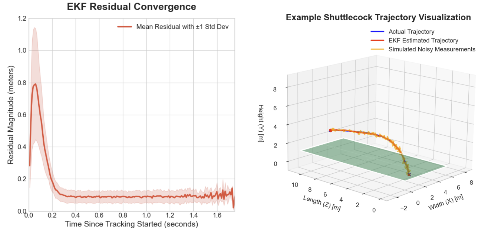

## What the prediction has to do

The stereo vision system outputs a stream of 3D positions: where the birdie
is right now, at each frame. The prediction system takes this stream of
coordinates and predicts where and when the birdie will land.

It does this by fusing each position measurement into a running state
estimate that tracks both position and velocity. The prediction module then
forward-simulates the trajectory under realistic aerodynamic drag to produce
a predicted landing location and time-to-arrival. This output is what the
robot will use in Year 2 to move to the correct court position before the
birdie arrives.

## Shuttlecock aerodynamics

A shuttlecock experiences significant drag due to its feathered skirt, so a
constant-acceleration model is insufficient. The shuttlecock can instead be
modelled as being subject to two primary forces: drag and gravity. Drag force
depends on velocity, so deceleration is most pronounced at high speeds and
decreases as the birdie slows.

Grouping the constants into a single term α = ρC_d A / 2m (units: m⁻¹) gives
the drag acceleration α|v|v. Decomposing the net force into its Cartesian
components yields a system of three coupled ordinary differential equations.
Knowing the position and velocity at a given moment lets us solve them and
calculate the entire trajectory of the birdie, both past and future flight
path. We used α = 0.215 m⁻¹, fitted to ground-truth Vicon data from a
published shuttlecock dataset, rather than fitting against our own data, as
live trajectory capture was not completed.

## The Extended Kalman Filter

The raw stereo vision measurements are inherently noisy due to sensor
limitations and environmental factors. An EKF combines the physics model
above with each new measurement to produce a cleaner state estimate.

The EKF tracks the 6D state [x, y, z, vx, vy, vz] of the birdie. Each frame,
the filter runs two steps: prediction, where the dynamics model propagates
the state forward, and update, where the triangulated 3D position is fused
with the prediction via the Kalman gain. The Kalman gain weights the
measurement against the model prediction based on their relative uncertainty.

Measurement noise is set to σ = 2 cm for X/Y and σ = 5 cm for Z, based on
physical reasoning and tuned against the published dataset. They have not
yet been validated against live camera data.

## Tracking and landing prediction

The tracker manages the EKF lifecycle through three states. In SEARCHING, the
system waits for two consecutive detections to estimate an initial velocity
before initializing the EKF. In TRACKING, each frame runs a predict-update
cycle, and if no detection is found, the filter coasts for up to 30 frames to
handle brief occlusions. Beyond this window, the tracker transitions to LOST
and resets for the next birdie.

Once the EKF state converges, a Runge-Kutta 4th-order integrator forward-simulates
the trajectory using the same aerodynamics model until the birdie
reaches a target intercept height, returning the predicted landing position
and time-to-arrival. RK4 is used rather than the EKF's 2nd-order integration
because small errors compound over a 1 to 3 second prediction horizon.

## Testing without a live detector

Without a working live detection pipeline, validating the EKF and landing
predictor required an alternative approach. The replay tool feeds
ground-truth Vicon trajectories through the full tracker stack and reports
per-frame EKF error and landing prediction convergence, allowing iterative
tuning of noise parameters and α without live cameras.

To validate the physics and EKF before live testing, random Gaussian noise
was injected into the dataset and fed into the EKF to simulate noisy camera
measurements. The output of our prediction algorithm was then compared
against the clean, ground-truth data.

The EKF converges quickly and is robust to measurement noise. It locks onto
the true trajectory in under 0.25 seconds, and once locked, the filter
achieves a steady-state mean positional error of less than 10 cm for the
remainder of the flight. Validated against 247 Vicon ground-truth
trajectories, the system achieves 3.6 cm mean tracking error, which is
sufficient for interception.
