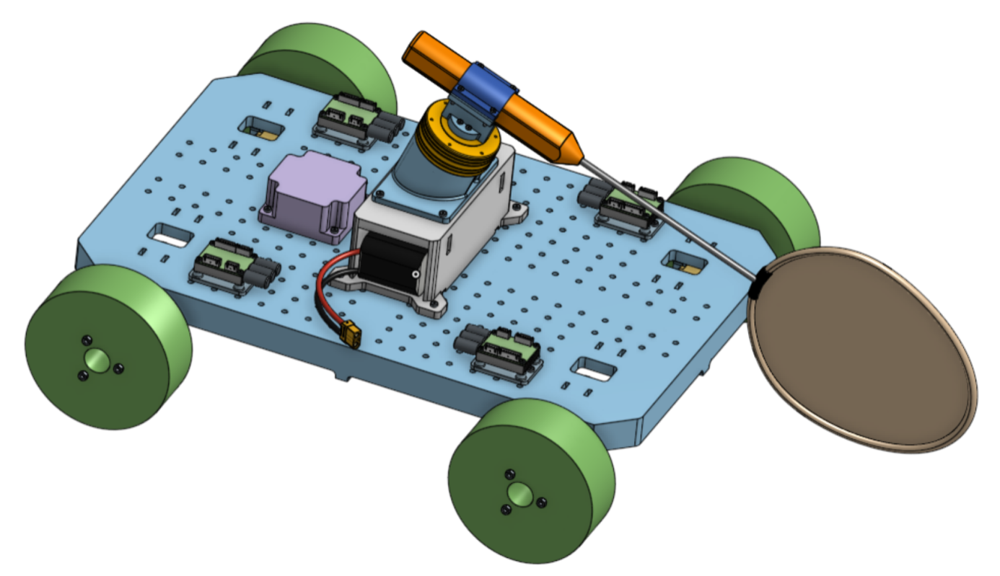
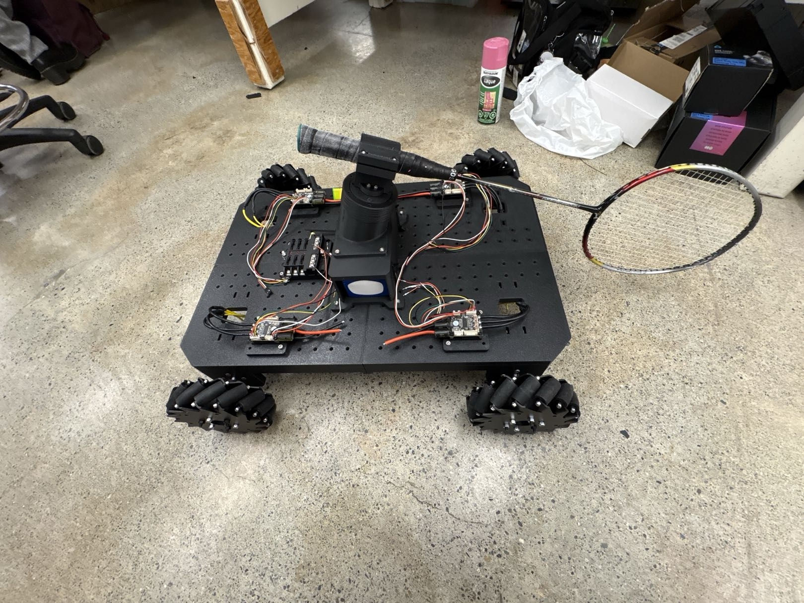
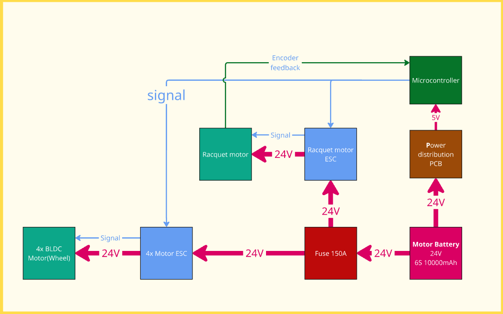

## What the robot has to do

We want the physical robot to traverse to the corners from the centre
within 2.5 seconds from the moment the birdie is struck. That distance is
roughly 3.7 metres, giving us a max speed and acceleration requirement of
2.95 m/s and 2.36 m/s² (assuming a triangular acceleration profile).

Given the racquet as the end effector, the striking arm needs to be swung at
approximately 400 RPM at birdie contact to enable a shot reaching the far
extremes of the court. These criteria drive the robot's weight budget and
motor selection.

## Drivetrain

The drivetrain is responsible for moving the robot to the predicted birdie
landing location within the allotted time. The design consists of four
individually driven 6-inch mecanum wheels mounted at the 4 corners of the
robot, which allows for omnidirectional motion through differential steering. 
This reduces weight and complexity. It also reduces travel time.

We chose the motor and gearbox system based on the requirements above, which
translates to output shaft requirements of 2.1 Nm at 650 RPM, with an
estimated robot weight of 18 kg. Maxon BLDC motors (6100 RPM at 0.285 Nm,
nominal) combined with a 10:1 planetary gearbox were selected due to their
high power density and compact size, while satisfying the RPM and torque
requirements under continuous operation.

## Striking arm

The striking arm sits above the chassis and actuates once the robot is at the
predicted landing location and the birdie reaches the striking height. The
arm consists of a badminton racquet clamped to the striking motor, installed
at a 25-degree angle to the floor (subject to change in the future). 
The arm has 1 degree of rotational freedom around a tilted vertical axis, 
which only enables an upwards return shot called a lift.

Although simple, lifts are more versatile and can be used against all types
of shots, whereas other methods of returning (like smashes) can only strike
the birdie at a specific height and angle. This is intentional, to keep the
scope of the project viable, as adding multiple DOF for more complex striking
options will deeply complicate the mechanical and electrical design.

Given the 90 kg·cm² moment of inertia of a badminton racquet, the motor
output needs to be 4.4 Nm at 400 RPM. A CubeMars robotic motor (4.5 Nm at 450
RPM) with a built-in encoder was chosen for its integrated controller and
gearbox. This motor meets our striking criteria and allows for precise
positional feedback and control, which is essential for controlling the
birdie's outgoing direction.

## Prototyping and manufacturing

With a footprint of 40 by 60 centimetres, the majority of the robot is 3D
printed for ease of fabrication and fast prototyping. It also allowed more
complex geometries than other prototyping methods, such as laser-cut and
water jet, while being more accessible and affordable than CNC machining.

PLA is used as the main material due to availability, ease of printing, and
high print quality. Parts under high cyclic load and/or temperature, such as
wheel hubs and motor mounts, were printed out of PPA-CF, which has much
higher stiffness and glass transition temperature. The chassis is printed in
four pieces and bolted together due to the print bed size of the available
printers. Patterned holes sized for threaded inserts are left throughout the
chassis.

## Electrical system

All electronics on this robot are off-the-shelf to eliminate potential risks
in designing custom PCBs. The robot runs on a 24V architecture. A 6S, 12C,
10000 mAh LiPo battery powers all electronics, enabling 20+ minutes of
continuous play. Power distribution to motors is done through a 6-way power
distribution block with integrated fuses, and each individual drive motor is
controlled by a VESC. The striking motor has an integrated controller and
encoder.

