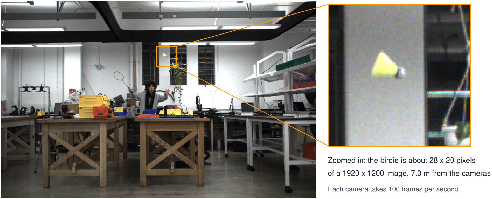
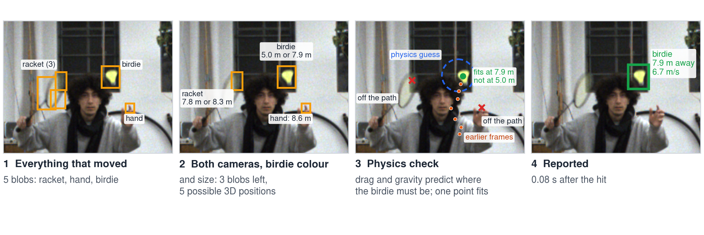
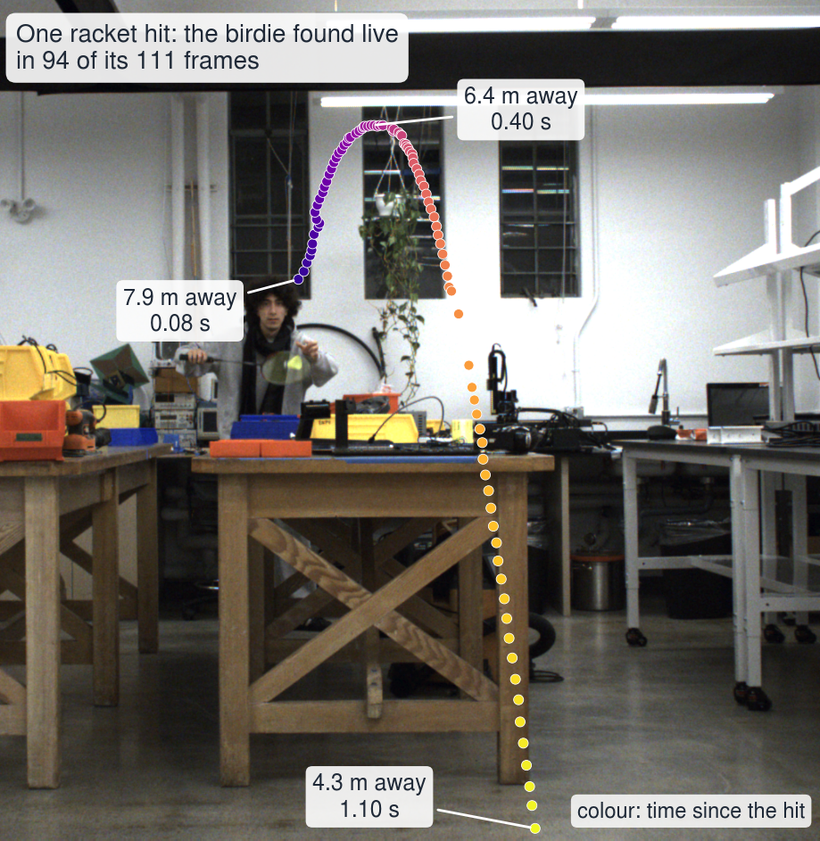
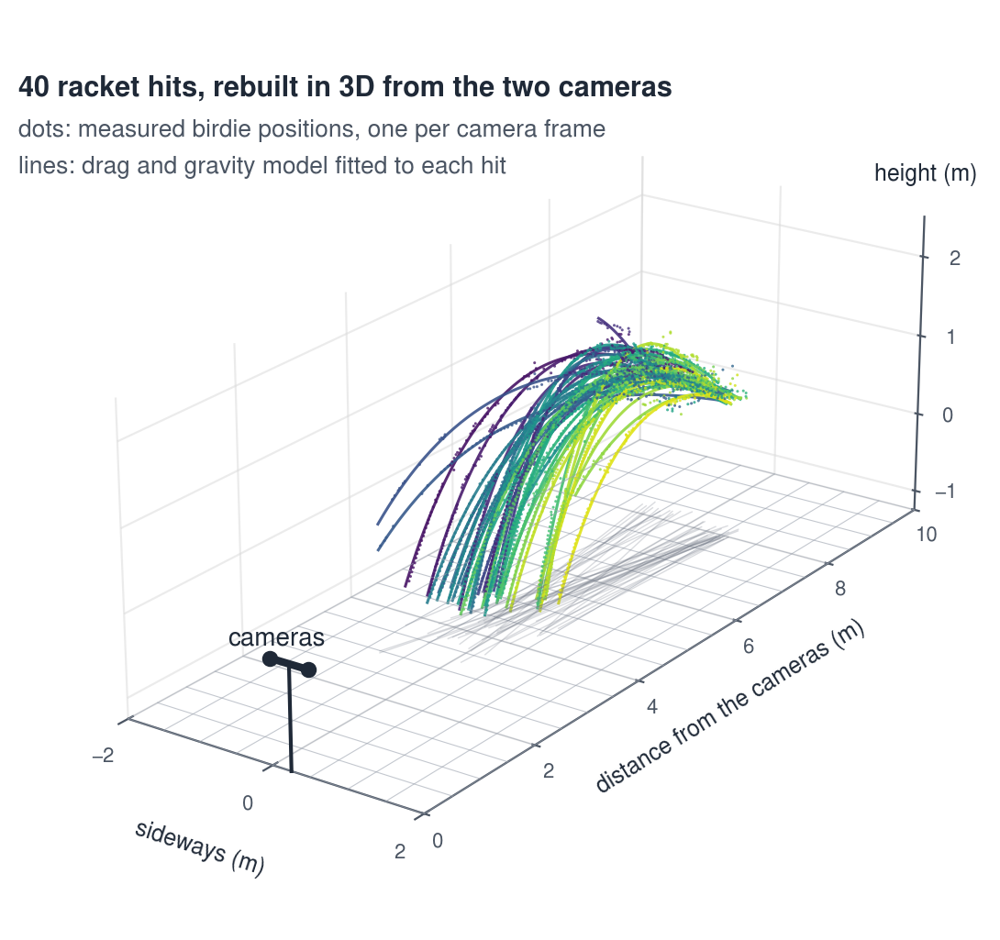
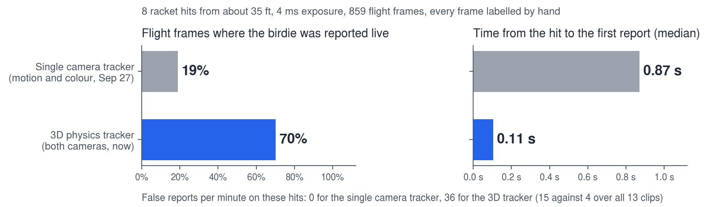

## How we got here

**Year 1: colour only.** We looked for birdie-coloured pixels. The short
exposures that freeze a fast birdie left the image too dark, so it failed
even in lab light.

**Sep 27: motion plus colour, one camera.** Finds what changed between frames
and keeps the yellow blobs. It only reports blobs moving fast in pixels, so a
far birdie gets dropped. This is the "single camera tracker" you'll see below.

**Oct 2: both cameras plus physics.** Every blob gets a 3D position, and only
one that flies like a birdie (drag plus gravity) gets reported.

## Picking the birdie out of the junk

Below is one real frame, 0.08 s after the hit. Background subtraction tells us five things have moved (5 blobs). Colour and size cut 5 blobs to 3. Then, using the value of depth, and its motion over time, we can pick out just the birdie's blob.

We look for the thing moving like a birdie!

## One hit

A single racket hit (full trajectory), with the birdie found live in 94 of its 111 frames. The
first live report is 7.9 m away, 0.08 s after the hit. The last is 4.3 m
away, 1.10 s after the hit, as the birdie leaves the bottom of the view.

Slowed down 4x, the whole hit lasts about 1.1 s. The green box is the birdie as detected. The blue ring is where drag and gravity said it would be this
frame. The orange dots are earlier frames, and the readout is distance and
speed, measured with both cameras.

<video src="/videos/tracker.mp4" muted loop autoplay playsinline controls style="max-width:100%"></video>

## All 40 hits

40 of 40 hits from about 35 ft were picked up. The typical gap between a 3D
point and its fitted flight is 1 to 3 cm, and the terminal speed of our
birdie, fitted from these flights, is 6.9 m/s.

## Before and after, same hits

The test set is 13 clips, 85 flights, about 49,000 frames labelled by hand (took me a long time).
The labels are so we can score the various tracker iterations.

On 8 racket hits from about 35 ft at 4 ms exposure, the single camera tracker
reported the birdie live in 19% of flight frames. The 3D physics tracker
reported it live in 70%. The median time from the hit to the first report
went from 0.87 s to 0.11 s. (More details on the winning tracker soon!)

