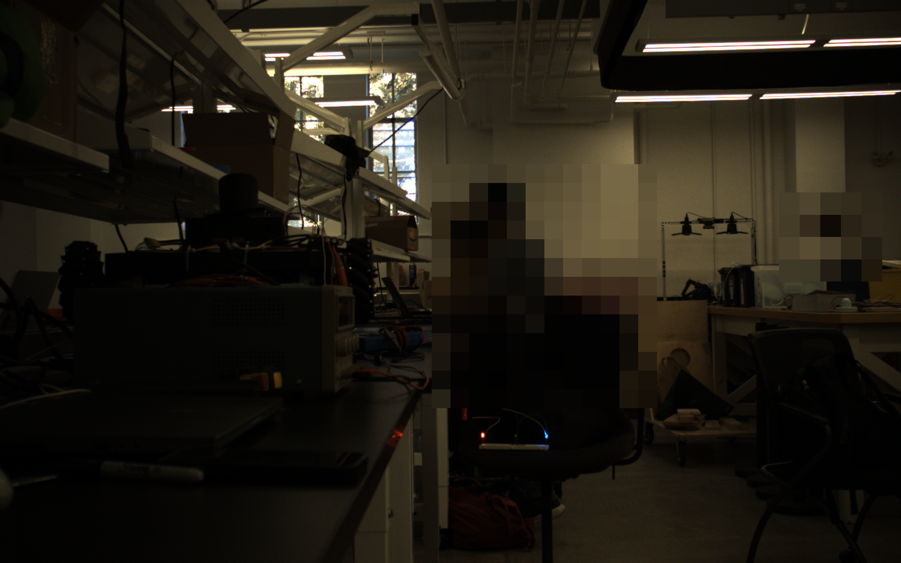
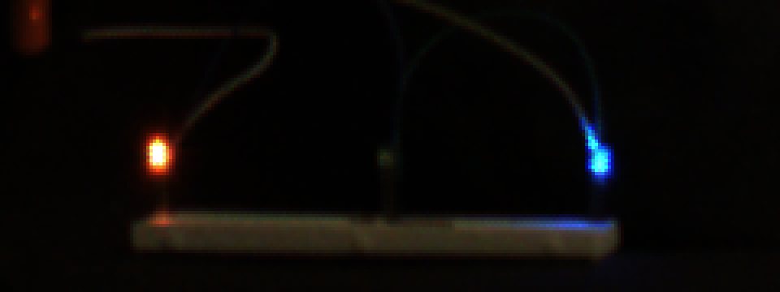
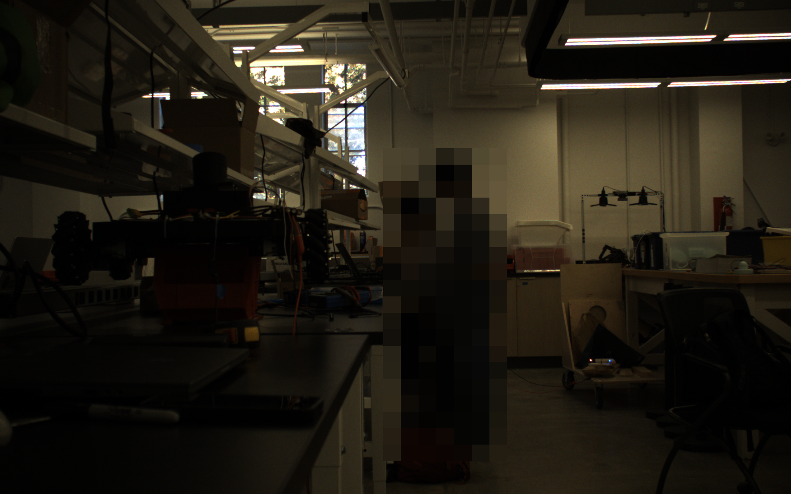
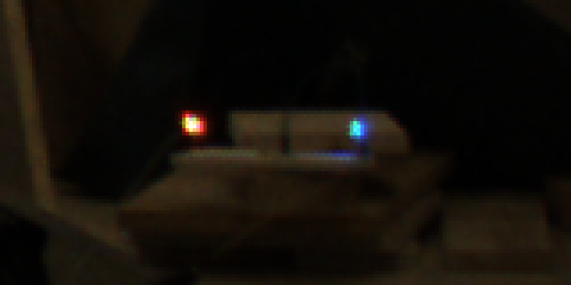

import { Image } from "astro:assets";
import closeup from "../../../assets/logbook/baddy-bot/leds-closeup-phone.png";

## What I'm trying to achieve

Today I want to test if the LEDs we bought ([red](https://www.digikey.com/en/products/detail/kingbright/WP9294SECK-J3/7318908), [blue](https://www.digikey.com/en/products/detail/visual-communications-company-vcc/VAOL-5701SBY4/4515700), [green](https://www.digikey.com/en/products/detail/visual-communications-company-vcc/VAOL-5701DE4/4515699)) will be bright enough at ~10 mA to localise the robot on the floor using the cameras.

## Closeup

Here's a closeup of them, taken with a phone camera. The green one is noticeably dimmer than the rest... too bad it's the LED of which we have the greatest quantity.

<Image src={closeup} alt="The red, green and blue LEDs in series on a breadboard at 20 mA, phone photo" style="margin-left:auto; margin-right:auto" />

## 3 m

Now, we want to test that one of the stereo cameras is able to see the LEDs at a great distance. Between the closeup and 3 m, we also moved the LEDs out from being bunched 1 cm apart to closer to 10 cm.

The image below shows the LEDs at 3 m away from the camera rig. You can tell the red LED is the brightest, as it's saturating (showing white) even with the same current as the blue one. The green one has clearly been eliminated as an option (it's very dim, and even at its maximum current it would only be about 1.5 times as bright).





## 10 m

And lastly at around 10 m, on the floor and at an angle, here it is in full view:



and zoomed in:



## Code

Capturing a 3 s clip from one camera, with the winning settings from the [previous log](/logbook/baddy-bot/2026-10-02-tracking-the-birdie-in-3d) (4 ms exposure, 12.3 dB gain):

```bash
./build/ninja/record_single --out ../recordings/E11_led_appearance/m3_10mA \
  --exposure 4000 --gain 12.3 --fps 100 --seconds 3
```

Cropping around the LEDs:

```python
raw = np.memmap(clip + '/frames.raw', np.uint8, 'r').reshape(-1, 1200, 1920)
bgr = cv2.cvtColor(np.ascontiguousarray(raw[150]), cv2.COLOR_BayerBG2BGR)  # raw bayer to colour
crop = bgr[y0:y1, x0:x1]  # a window around the leds
cv2.imwrite(out, cv2.resize(crop, None, fx=4, fy=4, interpolation=cv2.INTER_NEAREST))
```

## Next

Next we need to think about how we can use the red and blue LEDs in some arrangement such that we can use them to track the position of the robot, similarly to how we're doing it with the birdie.
